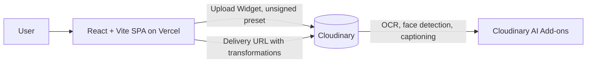

# SafeShare: Architecture

## 1. Overview
Serverless, client-only MVP. All AI processing is delegated to Cloudinary.



## 2. Stack
- Frontend: React 18, Vite, Tailwind CSS
- Media and AI: Cloudinary (Upload Widget, face detection, OCR Text Detection add-on, AI captioning or Google auto-tagging)
- Hosting: Vercel
- Docs: Notion, README

## 3. Folder structure
```
safeshare/
  docs/
  public/
  src/
    components/
      UploadCard.jsx
      CompareView.jsx
      Controls.jsx
      SharePanel.jsx
    lib/
      cloudinary.js     # widget loader and buildProtectedUrl()
    App.jsx
    main.jsx
  .env.example
  README.md
  LICENSE
```

## 4. Environment variables
```
VITE_CLOUDINARY_CLOUD_NAME=
VITE_CLOUDINARY_UPLOAD_PRESET=   # unsigned preset
```
Never commit the API secret. The client does not need it.

## 5. Cloudinary configuration
- Upload preset: unsigned, folder `safeshare`, allowed formats `jpg,png,webp`, max file size around 10MB
- Preset add-on params: `detection: captioning` (or `categorization: google_tagging`), plus `ocr: adv_ocr` if available on your plan. Verify add-on names in your Cloudinary console, since availability depends on plan and region.

URL builder (core logic):
```js
export function buildProtectedUrl(cloud, publicId, { faces = true, text = true, strength = 1000 } = {}) {
  const t = [];
  if (faces) t.push(`e_blur_faces:${strength}`);
  if (text) t.push(`e_blur_region:${strength},g_ocr_text`);
  t.push('q_auto', 'f_auto', 'w_1000', 'c_limit');
  // Each "/" creates a separate chained transformation component
  return `https://res.cloudinary.com/${cloud}/image/upload/${t.join('/')}/${publicId}`;
}
```
Check the exact syntax for `e_blur_region` and `g_ocr_text` against the current Cloudinary docs, since it requires the OCR add-on. If it fails, swap in `e_pixelate_faces`, or drop the text step.

## 6. Security and privacy notes (state these honestly in the pitch)
- With an unsigned upload, the original asset is publicly reachable by its `public_id`. Anyone with the protected link could modify the URL to fetch the original.
- Hardening (post-MVP): upload with `type=authenticated`, use signed delivery URLs via a tiny serverless function, or use `eager` transformations plus `access_mode`/strict transformations so only named transformations are deliverable.
- No user data is stored by SafeShare. No cookies or analytics.
- Strip EXIF/GPS using `fl_strip_profile`.

## 7. Performance
- `f_auto,q_auto` for format and quality
- Transformations are generated on first request and cached on the CDN. Warm demo images before presenting.

## 8. Failure modes
| Failure | Handling |
|---------|----------|
| Widget script blocked | Show message with retry |
| Add-on not enabled (400 on URL) | Fall back to faces-only URL and hide the text toggle |
| No caption returned | Use the first 3 tags to compose alt text: "Photo containing X, Y, Z" |
