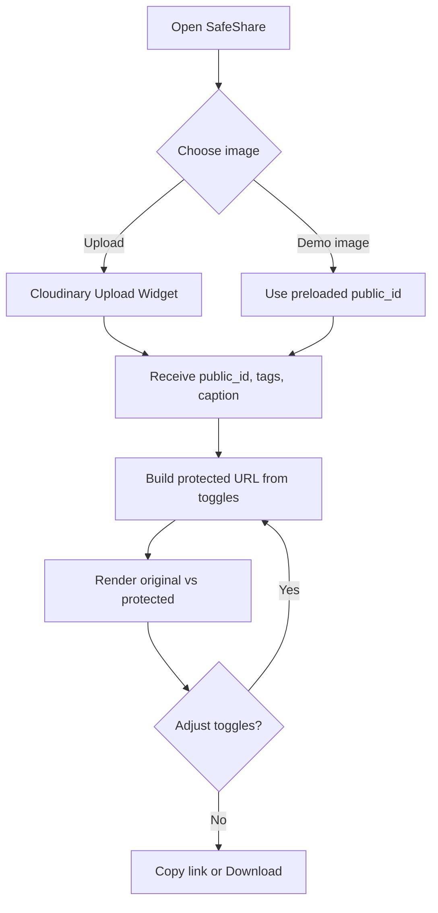
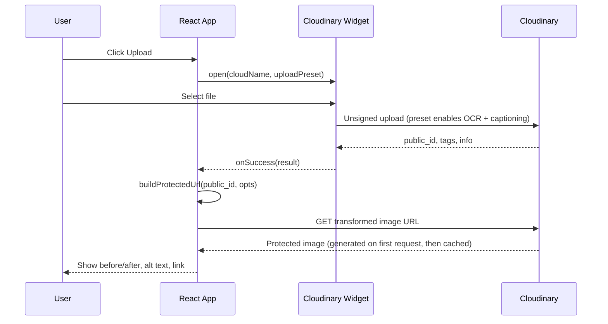

# SafeShare: Workflows

## 1. User flow

## 2. Technical sequence

## 3. Git workflow
- Branches: `main` (deployable), `feat/<name>`
- Commit style: `feat:`, `fix:`, `docs:`, `chore:`
- Merge via MR, 1 reviewer or self-review given the time limit
- Commit at least every 20 minutes (judges can see the history)

## 4. Notion documentation workflow
Pages: Problem, Users, Solution, Architecture, Build Log, Demo and Pitch.
Build Log entry format: `Time | What we built | What broke | How we fixed it | Screenshot`.
Add an entry after every milestone in PWD.md.

## 5. Release flow
1. `npm run build` passes
2. Deploy to Vercel with env vars set
3. Smoke test: upload, toggle, copy link on mobile and desktop
4. Tag `v0.1.0`
